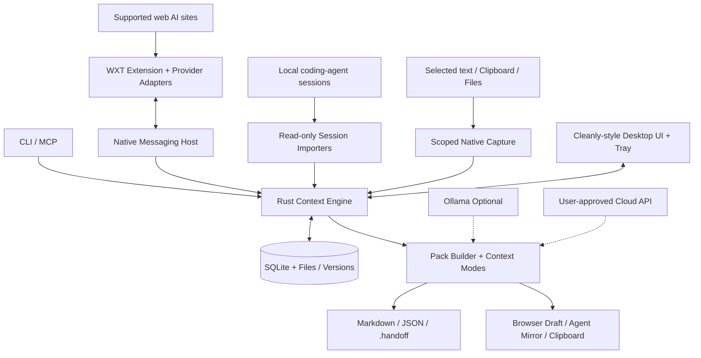

# Hopilo — Universal AI Session Handoff
## Product Requirements, UX Specification, and Technical Architecture

**Status:** Proposed specification · **Version:** 1.1 · **Date:** 3 November 2026  
**Platforms:** macOS, Windows, Linux · **Distribution:** Local-first desktop utility plus optional browser extension  
**Product name:** **Hopilo** · **Brand status:** Selected for the product specification; trademark, domain and store-name clearance still required

> **Product promise:** Capture the useful, user-visible context of work in one AI tool and continue in another—without re-explaining the project, losing files, or trusting a black-box summary.

---

## 1. Executive summary

Hopilo is a lightweight menu-bar/system-tray application with a full desktop dashboard. It captures conversations and work context from supported browser-based AI tools, locally stored coding-agent sessions, selected text, clipboard contents, files, and manual input. It normalizes material into a portable, versioned **Context Pack**, offers full/selected/compact handoff modes, and delivers a reviewed draft to another AI through an extension, clipboard, file, native coding-agent importer, CLI, or MCP server.

The full application adopts the **information architecture and visual approach of Cleanly**: grouped left navigation, generous whitespace, a prominent hero action, small overview cards, visually rich but legible interactive maps, command search, light/dark appearance, and a polished settings panel. It does **not** duplicate Cleanly's branding, assets, or exact implementation.

The drag workflows draw on **Capsule Hub**: create a pack by dropping sources, files, and text; drag a pack toward a supported AI composer for injection; combine or split packs; preserve attachments and version history; and eventually share packs with a team. Unlike a browser-only extension, Hopilo also supports desktop/session files and offline workflows.

### 1.1 User problem

A user doing software development in Claude reaches a usage limit, opens ChatGPT/Gemini/Grok/DeepSeek, and must manually repeat the goal, decisions, errors, file references, and next steps. Long chats can be virtualized; past attachments may not be downloadable; coding-agent sessions have tool-specific formats. Hopilo turns the recoverable information into a reusable context artifact and flags what could not be transferred.

### 1.2 Product goals

1. Move between AI tools in as few actions as possible.
2. Preserve **accuracy and traceability**, not merely produce a plausible-sounding summary.
3. Make **drag-and-drop** a first-class but never mandatory interaction.
4. Work offline for capture, storage, search, basic formatting, and exports.
5. Make the **full desktop UI feel like Cleanly** while keeping tray interactions tiny.
6. Support cross-platform native capture realistically: explicit permissions, adapters, and safe fallbacks.
7. Let users inspect, redact, edit, version, export, and delete their own information.
8. Provide developer interfaces without making the application into yet another AI chat client.

### 1.3 Explicit non-goals

- No attempt to transfer hidden chain-of-thought, provider-private KV caches, inaccessible system instructions, provider usage quotas, or proprietary memory.
- No bypassing provider authentication, subscriptions, rate limits, usage caps, or anti-bot measures.
- No unattended sending of prompts to an AI service by default.
- No claim that every third-party attachment or every previous chat can be recovered.
- No continuous scraping of all foreground windows or global clipboard history by default.
- No automatic overwrite or corruption of original coding-agent session files.

---

## 2. Inspiration and feature mapping

| Reference | Verified pattern | Hopilo interpretation |
|---|---|---|
| **Cleanly** | Sidebar + dashboard hero + small cards; searchable interface; bubble-based Space Map; Electron/React UI | Full-window design language, session overview, **Context Map** bubbles, command palette, restrained controls |
| **Capsule Hub (Tilantra)** | Capture, attachment bundles, drag/drop injection, versioning, team spaces, merge/split, dynamic context, MCP | Pack builder, extension-based drop targets, attachments, lineage graph, conditional context selection, optional collaboration |
| **Continuo** | Discover Claude Code/Codex/OpenCode sessions; convert or summarize; safe mirror files | Native-agent importers and conservative target-session adapters |
| **Context Transfer / context-shifter** | Menu-bar shortcut, selected-text capture, Ollama compaction, small floating panel | Quick Capture, selection capture, local summarization, fast handoff |
| **MoveChat / ContextBridge** | Browser transcript extraction, long-thread handling, structured export | Provider adapters, virtual-scroll capture status, import/export and attachment-aware recovery |
| **agenthop / session-migrate** | CLI session indexing, adapter ideas, cross-tool transfers | Extensible adapter contract, CLI, database index, test fixtures |

**Licensing rule:** The product may implement similar interactions independently. Do not copy Capsule Hub proprietary components or Cleanly's code, illustrations, icons, CSS, and trade dress without verifying reuse permission. Some other referenced projects are MIT/Apache-licensed; retain attribution and license notices whenever code is actually reused. The Cleanly repository list inspected for this specification did not visibly include a root LICENSE file; verify before considering any code reuse.

### 2.1 Source references

- Cleanly repository: https://github.com/0xCodez/cleanly
- Cleanly interactive presentation: https://getcleanly.vercel.app/
- Capsule Hub: https://capsulehub.tilantra.com/
- Capsule Hub feature documentation: https://capsulehub.tilantra.com/docs/features
- Continuo: https://github.com/yoavf/continuo
- Context Transfer: https://github.com/Shivala-08/context-shifter
- MoveChat: https://vc067.github.io/MoveChat/
- ContextBridge: https://github.com/vinchlabs/contextbridge
- agenthop: https://github.com/CyrusSE/agenthop
- session-migrate: https://session-migrate.github.io/

---

## 3. Product structure and experience principles

### 3.1 Two primary surfaces

**Quick Panel:** A compact tray/menu-bar popover for capture, recent sessions, quick search, output mode, and one-tap copy or handoff. Clicking the tray icon toggles the panel; its primary content must remain useful without opening the dashboard.

**Main Window:** A larger, resizable Cleanly-style desktop window for the complete library, Context Map, pack builder, detailed review, drag-based editing, versions, destinations, connections, activity log, and settings.

**Optional third surface:** A floating, non-activating **Drop Shelf** pinned near the edge of the display. It contains the selected pack and can be shown while switching AI windows. It must never obstruct a password field, remain always-on-top without permission, or silently enter content into applications.

### 3.2 Window preferences and behavior

| Preference | Suggested default | Behavior |
|---|---|---|
| Launch at login | Off | Explicit opt-in |
| Startup surface | Tray only | Option: tray only / restore last window / open Home |
| Close button | Hide main window | Option: quit application; on macOS follow familiar window conventions |
| Tray click | Toggle Quick Panel | Option: open full dashboard |
| Panel position | Anchor to tray | Fallback to cursor / selected corner where system cannot anchor reliably |
| Always-on-top Drop Shelf | Off | User-toggle, visible status |
| Window geometry | 1120 × 740 logical px | Minimum roughly 900 × 600; persist size and position per display |
| Sidebar | Expanded | Collapsible rail; keyboard navigable |
| Theme | Follow system | Light / Dark / System; avoid excessive translucency in high contrast |
| Motion | Follow OS | Reduced-motion mode disables bubble physics |
| Privacy mode | On for previews | Hide sensitive pack names in notifications or screen sharing |
| Hotkey | Configurable | Detect conflicts and show platform-appropriate shortcut |
| Open external destination | Default browser | Per-provider browser or desktop-app preference if supported |

Always make it clear whether a keyboard shortcut reads **selected text**, **active browser conversation**, or **local agent session**.

---

## 4. Cleanly-style visual and interaction specification

### 4.1 Window composition

The composition is visually inspired by the Cleanly dashboard rather than a traditional three-column IDE:

```text
┌────────────────────────────────────────────────────────────────────────────────────────────┐
│  ●  ●  ●      Hopilo                                  ⌘K Search              ⚙  ◯ │
├──────────────────────┬─────────────────────────────────────────────────────────────────────┤
│  ◆ HOME              │  Overview                                            [Capture ▼] │
│  ▸ Dashboard         │  ┌───────────────────────────────────────────────────────────────┐ │
│  ▸ Quick Capture     │  │  READY TO CONTINUE                                            │ │
│                      │  │  12 Context Packs                                             │ │
│  LIBRARY             │  │  From 4 AI sources · most recent 2 minutes ago                 │ │
│  ▸ All Sessions      │  │  [Capture current session]   [Create pack]                     │ │
│  ▸ Context Map       │  └───────────────────────────────────────────────────────────────┘ │
│  ▸ Packs & Versions  │                                                                     │
│  ▸ Attachments       │  CONTEXT MAP                                  [List] [Map] [Filter] │
│                      │       (Claude Code)          (ChatGPT)                              │
│  WORKFLOWS           │  (Gemini)         (DevDock)            (Architecture Notes)         │
│  ▸ Handoff           │      (API Migration)           (Research)                           │
│  ▸ Merge & Split     │                                                                     │
│  ▸ Destinations      │  ┌─────────────┐ ┌─────────────┐ ┌─────────────┐ ┌─────────────┐ │
│                      │  │ Sources     │ │ Recent      │ │ Handoffs    │ │ Privacy     │ │
│  INTEGRATIONS        │  │ 6 connected │ │ 3 today     │ │ 8 completed │ │ Local only  │ │
│  ▸ Browser           │  └─────────────┘ └─────────────┘ └─────────────┘ └─────────────┘ │
│  ▸ Coding Agents     │                                                                     │
│  ▸ MCP & CLI         │  Recently captured                                  [View all →]  │
│                      │  Claude · DevDock architecture · Full transcript · Captured 2m ago │
│  ⚙ Settings          │  ChatGPT · API strategy · Compact handoff · Captured yesterday     │
└──────────────────────┴─────────────────────────────────────────────────────────────────────┘
```

**Do not fill the dashboard with fake scores.** The hero should report real session availability and the cards should reflect actionable states, not invented productivity metrics.

### 4.2 Visual tokens

- **Mood:** Calm, premium, light-glass on supported OS surfaces; a structured dark equivalent.
- **Layout:** Sidebar about 210–232 px; content max width adjusted to viewport; 8 px spacing base; 12–20 px surface radii.
- **Typography:** Modern system-facing sans serif, purposeful display sizes for hero counts, monospaced type only for code, IDs, and token estimates.
- **Colors:** Neutral backgrounds and restrained accent; source-provider colors used only for identity; text contrast meets WCAG AA.
- **Elevation:** One primary content plane, subtle layers for panels; no continuous background animation.
- **Icons:** Use the original Hopilo app icon specified below for the launcher; create a separate legible monochrome tray/menu-bar glyph. Use provider marks only when brand guidelines allow.
- **Responsiveness:** Compact view collapses sidebar and reduces four cards to two per row; do not hide safety warnings.
- **Accessibility:** Keyboard reachable actions, list alternative for Context Map, screen-reader labels, focus rings, accessible drag alternatives.

### 4.2.1 Hopilo identity and application icon (v1.1)

The selected product name is **Hopilo** (pronunciation: **HOP-ee-lo**). Use this exact capitalization across the application title, installer, About screen, release notes, documentation, and CLI help. The brand promise is **“Keep your context moving.”** Descriptive subtitle: **“Universal AI Session Handoff.”** Do not imply the name is trademark-cleared until reviewed.


**Approved visual direction / supplied concept asset:** `Hopilo_App_Icon.png` is the high-resolution (1254 × 1254 px) generated concept master. It is a macOS-style rounded-square, blue-to-indigo/violet glossy icon, showing two message bubbles connected by a fluid ribbon and opposing curved arrows. The symbol conveys context continuity and transfers between assistants. Treat the concept as the design reference, not a guaranteed production-ready asset for every store or operating system.

| Asset | Design requirement | Usage |
|---|---|---|
| Main app icon | Rounded-square macOS aesthetic; blue → indigo/violet; prominent two-chat handoff symbol | macOS Dock, app grid, Windows shortcuts, Linux launchers (platform-specific outputs) |
| macOS icon set | Prepare tested 16, 32, 64, 128, 256, 512 and 1024 px variants with proper transparent bounds/masks as needed | Bundle as `.icns` / asset catalog according to release tooling |
| Windows icon set | Render 16/24/32/48/64/128/256 px sizes; confirm small-size contrast | Installer and `.ico` resources |
| Linux icon set | PNG/SVG variants appropriate to desktop environments; do not depend on macOS-only rendering | `.desktop` launchers / themes |
| Menu-bar / system-tray glyph | **Separate one-color simplified symbol**, no glossy background, minimal detail; follow system light/dark appearance | Status icon at 16–24 px or native platform density |
| App wordmark | Simple “Hopilo” in system-friendly typography; never shrink text into the tray glyph | About, onboarding, installer and website |

**Brand colors (starting points, not sampled specifications):** cyan highlight `#48D7FA`, core blue `#1178E8`, indigo `#3349CC`, violet `#7837DD`. UI surfaces must also work in neutral light/dark mode; do not saturate the entire Cleanly-inspired dashboard to match the app icon.

**Icon production QA:** Test at 16, 24, 32, 64, 128 and 1024 px on dark and light backgrounds; simplify the transfer arrows and message bars for small sizes. The provided icon uses a light external canvas, so the design team must produce proper transparent/masked exports rather than treating the white corners as alpha. Verify Apple's current icon requirements and other platform packaging rules at build time.

**Naming in code:** Use `hopilo` for the repository folder, CLI executable, packages and internal prefixes. Production bundle identifier: `io.coreify.hopilo`.

---

### 4.3 Main screens

**Dashboard:** Summary hero, Context Map, four metrics cards, recent captures, primary call-to-action, connection health, and last handoff result.

**Sessions:** Searchable/filterable collection of raw captured sessions, source, time, title, completeness, attachment count, tokens, and capture status.

**Context Map:** Cleanly-like bubble canvas. Each bubble represents a session or a pack; area may represent token size or attachment size, with the metric explicitly selectable. Drag to organize, select, merge, or add to the composer. Animations must respect reduced motion. Dragging bubbles is an organizational interaction, not a transfer to an external app by itself.

**Builder:** Central drop canvas with source chips/tiles, editable timeline, right-side inspector for provenance and attachments, and a sticky primary action (**Build Context Pack**).

**Review:** Side-by-side raw transcript and compiled context; exclusions/redactions, completeness notes, token budgets, warnings, and editable destination prompt.

**Handoff:** Provider selector, delivery method, context mode, target estimate, generated draft preview, and handoff log.

**Packs & Versions:** Version timeline/tree, rollback, compare, labels, tags, share/duplicate/merge/split, relationship graph.

**Destinations:** Connected browser(s), supported agent locations, default targets, test injection, compatibility status, and fallback behavior.

**Settings:** A separate screen using Cleanly-style grouped preference cards rather than a long dense form.

---

## 5. Full feature catalog

Every feature has a stable ID. **P0** means required for a coherent MVP, **P1** means first broad release, and **P2** means advanced roadmap. Proposed scope is not a claim of existing implementation or verified provider support.

### 5.1 Core capture

| ID | Feature | Scope | Detailed behavior |
|---|---|---|---|
| CAP-01 | One-click Capture Active Chat | P1 | Extension extracts visible and recoverable user/assistant turns from the active supported page; reports missing segments |
| CAP-02 | Local Agent Discovery | P0 | Enumerate recognized session files/databases read-only; display project, modified time, model, size |
| CAP-03 | Selected Text Capture | P0 | Explicit shortcut; use native selection APIs where permitted, clipboard fallback with careful restoration |
| CAP-04 | Clipboard Capture | P0 | User-triggered one-time import; no background clipboard monitoring |
| CAP-05 | Manual Capture | P0 | Paste text, insert notes, specify source label, save as reusable pack |
| CAP-06 | File/Folder Import | P0 | Drag files, choose files, folders with limits and confirmation; parse supported formats |
| CAP-07 | Full Transcript | P0 | Preserve role order, code blocks, timestamps when available, URLs, and source identity |
| CAP-08 | Selective Capture | P1 | Pick turns, ranges, selected blocks, or code snippets before building |
| CAP-09 | Smart Long-Chat Capture | P1 | Handle lazy-loaded/virtualized messages with progress, timeout, retry, and incompleteness warning |
| CAP-10 | Incremental Capture | P1 | Recognize previously captured message IDs and add only new turns without duplication |
| CAP-11 | Auto Title & Categorization | P1 | Deterministic fallback; optional local-model title and topic generation |
| CAP-12 | Capture Health | P0 | Explicit states: complete / partial / unsupported / permissions needed / failed |
| CAP-13 | Browser Tab Import | P1 | Explicit tabs permission; choose conversation to capture; never sweep all open tabs silently |
| CAP-14 | Batch Capture | P2 | Select multiple sessions with dry-run cost and file estimates |
| CAP-15 | Session Watcher | P2 | Opt-in scoped watch of supported local agent directories; never upload automatically |

**Provider adapter categories** (each marked individually after testing):

- **Browser first wave:** ChatGPT Web, Claude Web, Gemini Web.
- **Browser next wave:** DeepSeek, Grok, Perplexity, Copilot and other commonly used chat UIs.
- **Other services / future:** NotebookLM, Outlook/Gmail threads, Slack discussions, AI development products and custom chat widgets—only where user permissions, integration surface, and stable extraction exist.
- **Local agent first wave:** Claude Code, Codex CLI, OpenCode.
- **Local agent future:** Gemini CLI, Cursor, VS Code-related agent stores, Continue, Aider, and others through separately maintained adapters.

**Evidence requirement:** Every adapter records implementation version, last compatibility test, extracted message count, and known limitations. A provider being listed in marketing materials is not equivalent to passing extraction and injection tests.

### 5.2 Drag-and-drop: the centerpiece

| ID | Drag feature | Scope | Exact user interaction |
|---|---|---|---|
| DND-01 | Drop files into Builder | P0 | User drags files into main app; show preflight size/type/security preview; import on confirmation |
| DND-02 | Drop text snippets | P0 | Drag plain/rich text from another app; preserve readable text and origin if available |
| DND-03 | Drag source tiles/logos | P1 | Drag a supported source tile into Builder to request that source's capture; requires a selected tab/session, does not magically access account data |
| DND-04 | Drag session cards | P0 | Drag one or more internal sessions to Builder; display highlighted insertion zone |
| DND-05 | Drag Context Map bubbles | P1 | Reposition bubbles; drop on merge well or another pack to propose merge; must confirm |
| DND-06 | Drag pack to extension overlay | P1 | On supported AI sites extension displays **Drop Context Here**; delivery occurs through trusted extension bridge, then draft is previewed |
| DND-07 | Drag pack from app to desktop | P1 | Offer native `.md` / `.handoff` file drag if OS implementation supports it; otherwise Export File |
| DND-08 | Drag pack onto supported app window | P2 | Try only declared adapters with explicit permissions; fallback to clipboard or file and never blind keyboard automation |
| DND-09 | Drag attachments to pack | P0 | Show pending/accepted/rejected attachment status before saving |
| DND-10 | Merge by dragging | P1 | Drag multiple cards onto Merge target; preview conflict resolution and ordering |
| DND-11 | Split by dragging | P1 | Drag selected turns/files into a new pack lane; source pack remains unchanged unless specifically requested |
| DND-12 | Version pin & reorder | P1 | Reorder selected context sections and drag stable checkpoint onto comparison target |
| DND-13 | Floating Drop Shelf | P1 | User pins a small draggable pack tile over the desktop; clear drag handle and dismiss control |
| DND-14 | Keyboard equivalent | P0 | Select items then use Add to Pack, Merge, Export, or Send to Destination buttons |

#### Drag payload types

1. **Internal structured payload**: pack or session ID, version, drag intention, and signed short-lived app-local token. Never expose sensitive raw data in ordinary OS drag metadata.
2. **File payload**: export a temporary portable bundle when native file drag works; delete temporary copies after short TTL; minimize filesystem exposure.
3. **Text payload**: plain-text preview or formatted handoff on explicit request.
4. **Browser extension drop payload**: extension intercepts a known app-originated pack reference and requests the payload via the native host; do not expect arbitrary OS text drags to work on all protected web composer elements.

#### Drag acceptance states

`idle → hovering-valid / hovering-invalid → preparing → preview → inserted-draft / fallback / error`

The UI must distinguish **copied**, **file exported**, **draft populated**, and **message actually submitted**. Hopilo's default final state is **draft populated**. An **auto-submit** option, if ever implemented, must be disabled by default, visibly explicit, and supported only by vetted destinations.

### 5.3 Context extraction, intelligence, and handoff

| ID | Feature | Scope | Behavior |
|---|---|---|---|
| CTX-01 | Normalized Conversation | P0 | Provider-neutral roles, text, code, tool events, timestamps, attachment refs |
| CTX-02 | Goal / Constraints / Decisions | P1 | Extract structured brief; each statement links to source turns or is marked user-edited |
| CTX-03 | Current State / Next Steps | P1 | Preserve current task, completed work, unresolved blockers, exact next action |
| CTX-04 | Full Mode | P0 | Use actual recoverable transcript, with metadata and attachments |
| CTX-05 | Selected Mode | P0 | Use only user-approved turns/sections |
| CTX-06 | Balanced Mode | P1 | Structured brief plus essential excerpts and last N interactions |
| CTX-07 | Minimal Mode | P1 | Essential project state, hard constraints, next action, critical links |
| CTX-08 | Task-Aware Mode | P2 | Re-rank context by a specific new task, without silently discarding required constraints |
| CTX-09 | Token Budget | P1 | Destination-specific model/context settings, estimated size, overflow warnings |
| CTX-10 | Local Summarizer | P1 | Optional Ollama; clear installed-model and memory requirements |
| CTX-11 | Cloud Summarizer | P2 | User-configured paid API; preview transmitted content, show token/cost estimate where known |
| CTX-12 | Source Fidelity | P0 | Immutable raw input, deterministic ordering, attribution, cannot invent missing files/quotes |
| CTX-13 | Summarization Review | P1 | Compare raw vs compact sections, restore omitted details, flag low-confidence output |
| CTX-14 | Handoff Prompt Builder | P0 | Generate destination-ready instruction: continue task, review context, identify assumptions |
| CTX-15 | Delivery Preview | P0 | Show content, attachment list, estimated size, sensitive-data warnings before delivery |
| CTX-16 | Target Profiles | P1 | Per-provider formatting, document handling and size recommendations; not native-session compatibility unless tested |
| CTX-17 | Continuation Link | P1 | Store source → destination relation, date, handoff version and user-defined title |
| CTX-18 | Delta Handoff | P2 | Transfer only new decisions and turns since an earlier confirmed handoff |

**Critical accuracy rule:** A model-generated brief is a derivative view, not a replacement for the raw session. It must preserve literals such as file paths, commands, exact error messages, code snippets, and cited URLs without hallucinating values. The user can always open the captured source where it remains available.

### 5.4 Pack library and lifecycle

- **LIB-01 [P0]** Save, rename, delete, duplicate, favorite, pin, archive, restore, and search packs.
- **LIB-02 [P0]** Local SQLite metadata with transaction-safe writes and indexed search.
- **LIB-03 [P1]** Tags, folders, collections, project groups, filters, sorting, recently opened.
- **LIB-04 [P1]** Immutable version snapshots with labels, changeset, created-by, source IDs.
- **LIB-05 [P1]** Diff any two versions, rollback by creating a **new** version, never destructively rewrite history.
- **LIB-06 [P1]** Merge packs: source order, duplicate detection, conflict review, provenance tracking.
- **LIB-07 [P1]** Split packs by messages, sections, tags, attachments, or target audience.
- **LIB-08 [P1]** Relationships graph: originating sessions, derivative packs, and destinations.
- **LIB-09 [P1]** Checksums and duplicate import detection.
- **LIB-10 [P2]** Content search within attachments and transcripts, based on opted-in indexing policy.
- **LIB-11 [P2]** Local snapshots, backup/export, retention policy, secure delete guidance.
- **LIB-12 [P2]** Read-only import of compatible packs from other tools using open schemas/adapters.

### 5.5 Attachments and external references

- **ATT-01 [P0]** Add local files with type, size, checksum, origin, and optional preview.
- **ATT-02 [P0]** Support a small verified baseline: `.txt`, `.md`, `.json`, `.csv`, `.log`, source-code text, and images as original files; PDF stored as binary with optional text extraction.
- **ATT-03 [P1]** Extend to DOCX, XLSX, PPTX, HTML, YAML, and more via dedicated parsers, with tests and explicit limitations.
- **ATT-04 [P1]** Store original bytes only after user approval; default imported referenced external files to a local copy or explicit path link with a broken-link warning.
- **ATT-05 [P1]** Preview text/images and show file names, hashes, parser warnings, duplicate content and token estimates.
- **ATT-06 [P1]** Collect links, citation labels, and file references from transcript; distinguish fetched content from URL-only references.
- **ATT-07 [P1]** Target compatibility: inline text, attach original, attach generated bundle, or reference-only.
- **ATT-08 [P2]** OCR or image understanding only as opt-in, local capability or explicitly approved API use; no promise of universal visual reconstruction.
- **ATT-09 [P2]** Redact files/sections for destination-specific sharing without rewriting source history.

If an original provider attachment is inaccessible, show **Referenced but not recovered** with a link and a request to attach the original manually. Never claim the file was transferred.

### 5.6 Destinations and export

- **OUT-01 [P0]** Copy Full/Selected/Balanced/Minimal handoff to clipboard.
- **OUT-02 [P0]** Export Markdown and JSON; filename is stable and sanitized.
- **OUT-03 [P0]** Export `.handoff` archive with manifest, transcript, brief, attachments, and checksums.
- **OUT-04 [P1]** Browser extension draft injection into explicitly verified targets; leave unsent for review.
- **OUT-05 [P1]** Open target web AI or preferred desktop AI, choose in-place/isolated new conversation where supported.
- **OUT-06 [P1]** CLI export to stdout, file, selected agent format, or clipboard.
- **OUT-07 [P1]** Compatible coding-agent handoff brief imported into a new native session **only** when tested and authorized.
- **OUT-08 [P2]** Direct native-session conversion for supported agent pairs; create owned mirror files, never overwrite original sessions.
- **OUT-09 [P2]** MCP tools to list/search/read packs and retrieve a selected context snapshot.
- **OUT-10 [P2]** User-configurable destination templates, custom prompt prefix/suffix, and one-click send-to-app shortcuts.
- **OUT-11 [P2]** Share sanitized, encrypted bundle through the user's chosen file-sharing mechanism.

**Fallback order:** Verified extension draft injection → native-supported destination importer → file attachment/export → clipboard. No hidden automation to send credentials or submit chats.

### 5.7 Team collaboration and developer ecosystem (advanced)

- **TEAM-01:** Optional workspace creation and invitations, not required to run the app locally.
- **TEAM-02:** Owner/Admin/Editor/Viewer roles, collection-level permissions, read audit trail, expiration/revocation for shared links.
- **TEAM-03:** Review/approve versions, branch a pack for a specific team, merge after review.
- **TEAM-04:** Encryption with documented key ownership; server cannot claim zero-knowledge unless architecture actually guarantees it.
- **TEAM-05:** Self-hosted or bring-your-own sync backend as a later design decision.
- **DEV-01:** MCP server with tools: `list_packs`, `search_packs`, `read_pack`, `read_version`, `create_pack`, `append_to_pack`, `export_pack`; write actions require explicit authorization.
- **DEV-02:** CLI (`hopilo capture`, `list`, `show`, `build`, `export`, `handoff`, `doctor`) with JSON output.
- **DEV-03:** Adapter SDK for provider DOM extractors and local session importers, schemas and conformance tests.
- **DEV-04:** Optional snippets / assistant skills for developer tools; no assumption that all IDEs can install them.
- **DEV-05:** Local-only IPC integration for custom app widgets and chatbots, token-scoped and disabled by default.

---

## 6. End-to-end user flows

### Flow A — Claude usage limit → ChatGPT

1. User reaches a Claude usage limit with an ongoing software task.
2. User presses the capture shortcut in the active browser tab or clicks extension **Capture conversation**.
3. Extension detects supported Claude page and extracts accessible turns. If old turns are virtualized, it attempts the approved recovery routine and reports any gaps.
4. Desktop opens compact preview: title, source, message count, attachment count, recovered percentage/status.
5. User selects **Balanced** or **Full**, reviews exact paths/errors/decisions, and chooses **ChatGPT**.
6. Extension opens or focuses the chosen destination and inserts a **draft** into its composer. Attachments are added only if the integration supports them and the user approves.
7. User sees **Draft ready—review and send**. Submission remains the user's decision.
8. Hopilo logs the handoff as `drafted`, followed by optional user-confirmed `sent`, and links the source pack to the target conversation if the target exposes an identifier.

### Flow B — Claude Code → Codex CLI

1. Tray panel lists discovered local Claude Code session and its project directory.
2. User chooses **Continue in Codex**.
3. Core reads original session **without modification**, normalizes conversation/tool summaries and selects full or brief mode.
4. If a compatible importer is enabled, it writes a new owned Codex-compatible mirror and launches destination; otherwise generates a handoff prompt and offers clipboard/file import.
5. A human-readable record states which tool messages were translated, omitted, or summarized.

### Flow C — Drag to create a pack

1. User opens Builder, sees a large drop surface styled with light-glass panels.
2. User drags two existing sessions, a requirements PDF and an optional pasted note onto the surface.
3. Tiles show role (source / reference / instruction), file access, duplicate warnings, and ordering.
4. User drags a session onto another to request merge or uses explicit **Merge**.
5. Hopilo compiles a non-destructive pack, prompts on conflicting constraints, then saves version 1.
6. User may drag the resulting pack into a compatible browser chat extension overlay, or export/copy it.

### Flow D — Long-running versioned project

1. User creates pack `Project X — Auth Migration`.
2. Over successive Claude, ChatGPT and coding-agent sessions, the user imports new turns.
3. Hopilo shows source lineage, versions, changed decisions, and optional relevant-context suggestions.
4. User branches `Backend`, `UI`, and `QA` packs by splitting source turns.
5. Updated branches may be merged into a reviewed parent version without deleting existing snapshots.

### Flow E — Offline and unsupported destinations

1. User selects text in an unsupported application with system selection access or manually copies it.
2. Quick Panel receives it as an unverified manual source.
3. User compiles a pack without any model API; no AI account is necessary.
4. Hopilo copies Markdown, exports a file, or opens the destination application for manual paste.
5. UI labels the handoff **Copied/Exported** rather than claiming the destination received it.

---

## 7. Screen-by-screen UI requirements

### 7.1 Quick Panel (tray/menu bar)

```text
┌──────────────────────────────────────┐
│ ◆ Hopilo             ⌕      ⚙  │
│ Capture                            ⌄│
│ ┌──────────────────────────────────┐ │
│ │ Capture selection       ⌘⇧C      │ │
│ │ Capture browser session          │ │
│ │ Import file / text               │ │
│ └──────────────────────────────────┘ │
│ RECENT                               │
│ ● DevDock architecture   Claude      │
│ ● Database migration     ChatGPT     │
│ ○ Exam research          Gemini      │
│                                      │
│ Selected: DevDock architecture       │
│ [Copy] [Drag / Handoff ▸]            │
│                                      │
│ Open Dashboard           Quit        │
└──────────────────────────────────────┘
```

Do not put a full sidebar inside the tray panel. Keyboard and screen-reader users should have the same abilities as drag users.

### 7.2 Pack Builder

```text
┌─────────────────────────────────────────────────────────────────────┐
│ Create Context Pack                            [Save Draft] [Build]  │
├────────────────────────────────────────────────┬────────────────────┤
│ SOURCES                                       │ PACK INSPECTOR      │
│ [Claude] [ChatGPT] [Gemini] [+ Other Source] │ Title, tags        │
│                                                │ 1,212 lines        │
│  ┌──────────────────────────────────────────┐  │ 3 source sessions │
│  │ Drop sessions, AI sources, files or text │  │ 2 attachments     │
│  │                                          │  │                    │
│  │  [Session A]  [Session B]  [PDF]         │  │ Validation         │
│  │    ↳ drag to reorder, merge or split     │  │ ● 3 imported       │
│  └──────────────────────────────────────────┘  │ ◌ PDF text partial  │
│                                                │                    │
│ [Add Text] [Add File] [Select Messages]       │ [Review Sources]   │
├────────────────────────────────────────────────┴────────────────────┤
│ Mode: Full / Selected / Balanced / Minimal    [Preview] [Build Pack]│
└─────────────────────────────────────────────────────────────────────┘
```

### 7.3 Handoff review

Left column: source timeline, original turn count, missing items, warnings. Middle column: editable generated brief with clickable source citations. Right column: destination, delivery method, token budget, attachment status, preview text, and primary **Prepare Draft** action. On narrow windows, use tabs rather than squeezing all three columns.

### 7.4 Context Map bubble behavior

- Bubble title: session/pack name, provider icon, size indicator.
- Size metric: **token estimate**, **message count**, or **attachment size**, always user-selected and labeled.
- Click: select. Double-click or Enter: open details. Multi-select: Shift/Ctrl/Command.
- Drag to another pack: **propose merge** with confirmation; dragging to blank canvas just moves the bubble.
- Drag to target rail: **Add to Builder**, **Create Branch**, **Export**.
- During drag: avoid overlapping text; show semantic drop highlights, no aggressive bouncing.
- Reduced motion / low-end hardware: static position and list alternative.

---

## 8. Preferences / Settings — full specification

The Settings screen uses grouped Cleanly-like cards with short descriptions, clear toggles, and immediate save/undo status.

| Category | Controls |
|---|---|
| General | Language; launch at login; restore last window; close-to-tray; background execution; update channel; notifications |
| Appearance | Light/dark/system; accent; translucency; compact density; sidebar state; animations; contrast |
| Window & Tray | Default startup surface; tray click behavior; Drop Shelf location/opacity; multi-display behavior; remembered size |
| Capture | Hotkey; selection capture strategy; clipboard restore; explicit browser capture; partial-content policy; local-agent directories; ignored apps |
| Browser | Extension connection and permissions; per-browser status; active tab behavior; provider adapter tests; auto-open target tabs |
| Storage | Data directory; storage used; attachment limits; retention; backup/export/import; verification; wipe all local content |
| Context Engine | Default mode; chunking; token budget; last-N-turn policy; summary prompt template; rule-based fallback |
| AI Providers | Ollama detection and model; optional cloud providers; encrypted API key storage; test connection; payload preview; cost settings |
| Handoff | Default target; browser/app mapping; inject as draft; clipboard formatting; attachment policy; fallback order; handoff history |
| Privacy | Hide previews; scan/redact secrets; excluded directories/apps; approve cloud transmission; encrypt sensitive pack content |
| Integrations | Local agent adapters; custom paths; MCP server toggle; CLI path; registered native messaging hosts |
| Accessibility | Reduced motion; keyboard-only workflows; larger labels; screen reader announcements; focus behavior |
| Advanced | Diagnostic logs with redaction; export debug report; reset adapter cache; database integrity check; developer mode |
| About | Version, licenses, release notes, update check, support, privacy policy |

**Important:** Never ask for macOS Accessibility or screen capture permission at initial launch if the user only wants clipboard/file importing. Explain the exact feature and request permission at first use. For a cloud summarizer, show what content will leave the device.

---

## 9. Storage and portable format

### 9.1 File types

- **`.handoff`**: ZIP-compatible portable archive, immutable manifest, normalized transcript, generated briefs, attachments, hashes, optional export encryption. Must be versioned.
- **`.md`**: Readable context for any AI with plain-text input.
- **`.json`**: Machine-readable snapshot for tools and extension developers.
- **`.txt`**: Minimal fallback for inaccessible environments.
- **`.pdf`**: Optional later human-readable report, not the canonical interchange format.

### 9.2 Archive layout

```text
project-auth-v3.handoff
├── manifest.json
├── conversation/
│   ├── normalized.json
│   └── transcript.md
├── context/
│   ├── full.md
│   ├── balanced.md
│   ├── minimal.md
│   └── handoff-prompt.md
├── attachments/
│   ├── 5c12...-requirements.pdf
│   └── 98ab...-diagram.png
├── provenance/
│   └── source-map.json
└── checksums.sha256
```

### 9.3 Minimal JSON schema illustration

```json
{
  "schemaVersion": "1.0.0",
  "packId": "01JDEMOULIDPLACEHOLDER",
  "title": "DevDock architecture handoff",
  "version": 3,
  "createdAt": "2026-11-03T10:00:00Z",
  "sources": [
    {
      "sourceId": "src-1",
      "kind": "browser-chat",
      "provider": "claude",
      "captureStatus": "partial",
      "missingItems": ["Original PDF attachment unavailable"]
    }
  ],
  "messages": [
    {
      "id": "m1",
      "sourceId": "src-1",
      "role": "user",
      "createdAt": null,
      "blocks": [{ "type": "text", "text": "Design the SwiftUI architecture..." }]
    }
  ],
  "context": {
    "goal": "Continue the active software design task",
    "decisions": [],
    "constraints": [],
    "currentState": "Architecture review in progress",
    "nextSteps": ["Review interface contracts"]
  },
  "attachments": [],
  "redactions": [],
  "provenance": [],
  "integrity": { "algorithm": "sha256" }
}
```

This is an illustrative minimal envelope, not an exhaustive published JSON Schema. The implemented schema must define validation, block types, message IDs, source citations, optional timestamps, version migration, and unknown-field handling.

### 9.4 Local SQLite entities

```text
projects
sources
sessions
messages
message_blocks
attachments
packs
pack_versions
pack_version_sources
pack_sections
redactions
handoffs
destinations
adapter_status
provider_profiles
settings
activity_events
```

Use stable identifiers, foreign keys, explicit SQLite migrations, content hashes, and transactions for saving a pack with attachments. Raw transcripts and immutable version snapshots are stored separately from edited briefs. Avoid storing API keys in SQLite plaintext.

### 9.5 Encryption and search tradeoff

A database can have searchable plaintext indexes **or** strong at-rest encryption of the indexed content, but not transparently both without a deliberate compromise. Recommended first release: OS-managed secrets + restricted local files + optional encrypted archive export; subsequent release: encrypted sensitive pack bodies with a documented index policy (or SQLCipher with transparent FTS inside the encrypted DB). Never label basic SQLite storage as end-to-end encrypted.

---

## 10. Architecture and technology recommendation

### 10.1 Proposed stack

| Layer | Choice | Rationale |
|---|---|---|
| Desktop shell | **Tauri 2 + Rust** | Compact resident utility, cross-platform window/tray access, native core |
| Full UI | **React + TypeScript + Vite + Tailwind/shadcn-style primitives** | Cleanly-like composition, accessible component system, reusable patterns |
| Browser extension | **WXT + TypeScript** | Single adapter-based extension codebase for Chromium and Firefox (tested separately) |
| Local indexing | **SQLite + FTS5** | Fast metadata/session search; no required backend |
| Local files | Rust filesystem services | Scoped importers, hash verification, reversible backups |
| Normalization | Rust `serde` domain types | Shared versioned schema, deterministic converters |
| Bridge | Small standalone Rust **Native Messaging host** | Authorized extension ↔ desktop communication without an exposed HTTP endpoint |
| Optional summarizer | Ollama | Runs locally when installed; never required for core functions |
| Optional cloud | User-configured API client | Opt-in paid provider, payload preview, secure key storage |
| CLI / MCP | Rust binaries sharing core crates | Useful for coding agents and scripts without starting dashboard |
| OS drag adapters | Per-platform native layer | Bridge native file/text drags where supported; extension-based injection elsewhere |

**Why not Electron by default?** Cleanly uses Electron, but matching its visual layout does not require the same runtime. Tauri is attractive for a small always-running resident app. If release testing reveals poor native outgoing drag interoperability on a target platform, either add a narrow native adapter or re-evaluate Electron for that platform; do not promise universal cross-app drag solely based on a webview's HTML drag API.

### 10.2 Logical architecture



### 10.3 Monorepo structure

```text
hopilo/
├── apps/
│   ├── desktop/               # Tauri + React app / shell / UI
│   └── extension/             # WXT content scripts and provider UI
├── crates/
│   ├── core/                  # data types, orchestration, normalization
│   ├── adapters/              # local agent session readers
│   ├── pack-format/           # import/export, validation, migrations
│   ├── capture-native/        # OS selection, clipboard, source discovery
│   ├── database/              # SQLite migrations and repositories
│   ├── native-host/           # native messaging stdio executable
│   ├── cli/                   # shell entrypoint
│   └── mcp-server/            # opt-in MCP integration
├── packages/
│   ├── schemas/               # generated JSON Schema + TS definitions
│   ├── ui/                    # reusable UI + tokens
│   └── adapters-web/          # provider-specific browser extractors
├── fixtures/                  # anonymized test transcripts
├── docs/                      # architecture decisions and release notes
└── .github/workflows/         # macOS / Windows / Linux CI
```

### 10.4 Extension ↔ desktop contract

A content script cannot call Native Messaging directly; send a scoped request to the extension's background/service-worker process, which communicates with the registered native host. Browser and extension identities must be allowlisted at the host. Cross-browser host manifests and registration paths differ and are installed by the desktop setup flow.

Illustrative commands:

```ts
type BridgeRequest =
  | { type: 'hello'; protocol: '1'; requestId: string }
  | { type: 'capture.import'; requestId: string; provider: string; payload: unknown }
  | { type: 'pack.getDraft'; requestId: string; packId: string; version: number; target: string }
  | { type: 'handoff.record'; requestId: string; packId: string; target: string; status: 'drafted' | 'failed' };

type BridgeResponse =
  | { requestId: string; ok: true; result: unknown }
  | { requestId: string; ok: false; error: { code: string; message: string } };
```

**Transport limits:** Chrome documents relatively small native-host→extension messages (1 MiB) and larger extension→host messages (64 MiB), so large payloads require chunking, explicit size caps, or user-initiated file import. Do not send raw attachment bytes in a single giant message. Native host may only serve its own extension; never expose arbitrary local data to unrelated pages.

### 10.5 Provider adapter interface

```ts
interface WebProviderAdapter {
  id: string;
  displayName: string;
  supportedHosts: string[];
  detect(): Promise<boolean>;
  capture(options: { includeOlder: boolean; abortSignal: AbortSignal }): Promise<NormalizedCapture>;
  prepareDraft?(pack: HandoffDraft): Promise<DraftResult>;
  auditCompatibility(): Promise<AdapterHealth>;
}
```

Local agent adapters have distinct read-only `discover`, `read`, and optional controlled `createOwnedMirror` methods. Do **not** implement them by pretending all agent databases are writable in the same format.

---

## 11. OS and browser compatibility matrix

| Capability | macOS | Windows | Linux |
|---|---|---|---|
| Main desktop UI | Required | Required | Required |
| Tray/menu-bar icon | Required | Required | Required, subject to tray support of desktop environment |
| Clipboard and explicit file import | Required | Required | Required |
| Selected-text capture | Accessibility API + fallback | UI Automation/selection + fallback | X11/Wayland-specific permission and portal limitations; manual fallback |
| Global shortcuts | Required with conflicts checked | Required with conflicts checked | Best effort; Wayland compositor restrictions may apply |
| Outgoing native file drag | Adapter and test | Adapter and test | Best effort; X11/Wayland-dependent |
| Browser draft injection | Extension | Extension | Extension |
| Local session discovery | Scoped user home locations | Scoped user profile locations | Scoped XDG/home locations |
| Startup at login | User opt-in | User opt-in | XDG autostart/system integration where available |
| Native host registration | Per-browser host manifest | Per-browser registry/manifest | Per-browser manifest directories |
| Secure key storage | Keychain | DPAPI / Credential Manager | Secret Service / libsecret if available; otherwise warn and refuse unsafe plaintext secret persistence |

**Browser priority:** Chrome/Edge/Brave first, Firefox next, Safari only after a separate feasibility assessment and native extension packaging. Browser detection alone does not guarantee support for arbitrary rich-text editors.

---

## 12. Security, permissions, and trust model

### 12.1 Local-first baseline

- Capture requires an explicit user gesture, a narrowly scoped enabled feature, or an opt-in approved watcher.
- Default local storage; no login required for personal packs.
- No analytics or telemetry by default. Optional update checks do not include session content.
- Optional cloud summarization is **off** until configured; show exact provider, destination endpoint, estimated payload, and redactions.
- APIs and secrets stored in OS secure storage only; scrub logs and crash reports.
- File import resolves real paths, checks symlinks, import limits, content type, zip-bomb characteristics, and parser safety.
- Native coding-agent files are **read-only source data**. Do not overwrite real agent state; mirror outputs must be owned, named, and verifiable.
- Extensions request minimum site permission at capture/injection time where possible; native host allowlists extension IDs.
- Imported chats can contain malicious instructions. Treat transcripts and attachments as **untrusted reference material**, never as application configuration or higher-priority system instructions.
- User can preview and redact emails, keys, access tokens, local absolute paths, and personally identifying information before sending.

### 12.2 Encryption and sharing

Personal local packs stay local by default. Optional cloud sharing must state what the server sees, who controls keys, and whether data is end-to-end encrypted. Link expiration, revocation, audit history, and sharing prompts are required before team rollout.

### 12.3 Failure and recovery

- Partial capture: do not silently announce success; show count and missing ranges.
- Bad summary: retain raw source and allow retry or deterministic brief.
- Browser DOM changed: disable affected injector and offer copy/export.
- Native host disconnected: reconnect/diagnose, then clipboard fallback.
- Target rejected attachments: attach compatible files only and show what was skipped.
- Duplicate content: suggest merge/reuse, not destructive overwrite.
- Database migration failure: preserve backup and offer a recovery route.
- Sensitive data detection: notify before any cloud transfer, never automatically send.

---

## 13. Nonfunctional requirements and acceptance targets

These are **proposed engineering acceptance targets**, not measured performance claims.

| Area | Target |
|---|---|
| Startup | Tray-only startup remains responsive; target UI ready in ~2 s on a typical current desktop, measure per OS |
| Idle behavior | No CPU-heavy loops, no polling entire browser sessions; track actual memory usage in CI/perf runs |
| Offline reliability | Capture imported text/files, search local content, build deterministic full/selected packs, export all formats without network |
| Large sessions | Streaming parse, bounded memory, cancelable progress, explicit incomplete capture state |
| Data integrity | Every export validates schema and SHA-256; replayable import/export fixture suite |
| Accessibility | All primary workflows complete without mouse drag; focus and spoken status tested |
| Privacy | Zero external content requests unless user configures or invokes an external integration |
| Error clarity | Each provider operation yields actionable status, not generic success toast |
| Cross-platform | CI builds Windows, macOS ARM/Intel where available, and Linux packages; smoke tests by platform |
| Adapter health | Recorded compatibility version and tests for extraction and injection |

### Acceptance scenarios

1. **Claude → ChatGPT**, 50-turn browser chat: capture with verified completeness indicator, build Balanced pack, insert unsent draft, show attachment exclusions.
2. **Offline file pack:** import Markdown + JSON + image, save locally, export `.handoff`, reimport without corruption.
3. **Local agent:** discover a test Claude Code session, read without modifying original bytes, create full and compact pack.
4. **Versioning:** create v1/v2, compare changes, rollback as v3, verify original versions unchanged.
5. **Merge/split:** merge two packs with duplicated content, review conflicts; split selected turns into new pack while preserving provenance.
6. **Unsupported provider:** export/copy works without any claim of successful direct injection.
7. **Security:** native host rejects an unapproved extension ID; malicious URL or symlink does not expose arbitrary filesystem data.
8. **Keyboard-only:** create, review, and hand off a pack without a drag gesture.
9. **Network off:** deterministic capture/import/export, library, and context review still work.
10. **Cloud opt-in:** app displays what will be sent and never calls cloud API unless consent and key configuration are present.

---

## 14. Development plan and milestones

### Phase 0 — Discovery, design system, and contracts

- Translate Cleanly's layout patterns into **original** Figma/HTML mockups (light, dark, compact).
- Validate drag behavior on macOS, Windows, Linux and target browsers before promising cross-app drops.
- Create schemas, feature flags, adapter contracts, privacy threat model, accessibility baseline, and sanitized fixtures.
- Produce clickable demo of Dashboard, Quick Panel, Builder, Drop Shelf, Review, and Settings with fake data.

**Exit:** approved interactions, documented platform limits, UI preview, a stable schema contract.

### Phase 1 — Local-first MVP

- Tauri desktop shell, icon/tray, main window, sidebar, command search, preferences.
- Local SQLite library; manual text/clipboard/file import; first local agent reader.
- Full and selected modes; Markdown/JSON/`.handoff` exports; copy to clipboard.
- Builder drop zone, session cards, pack preview, full source/attachment audit.
- Permissions-on-use and no-cloud privacy default; tests and packaging.

**Exit:** a user can capture from files or local sessions and move context to any AI by copy/export.

### Phase 2 — Browser capture and drag injection

- WXT extension; native messaging host registration; Chrome-family support.
- First verified web extractors for ChatGPT, Claude, and Gemini.
- Browser **Drop Context Here** overlay and draft injection; support large conversation capture with completeness warnings.
- Full/Selected/Balanced/Minimal; local Ollama optional; target profiles and token budget estimates.
- Version 1 compatibility dashboard and adapter failure fallbacks.

**Exit:** Claude web → ChatGPT web handoff can be completed through a reviewed draft with working fallback.

### Phase 3 — Cleanly-style advanced experience

- Context Map bubble canvas with drag organizing, merging, branching and accessible list.
- Full version graph, diff/rollback, project collections, smart search, incremental capture.
- Floating Drop Shelf, outgoing file drag adapters, Firefox integration, extended web provider support.
- More local coding-agent formats, integrity auditing, pack relationships.

**Exit:** robust multi-session workflows and proven user value on all target operating systems.

### Phase 4 — Developer and collaboration platform

- CLI, opt-in MCP server, adapters SDK, self-hosted integration examples.
- Native-session conversion where validated; task-aware filtering and cloud API opt-in.
- Optional encrypted sharing, workspaces, roles, review workflows, and sync after security review.
- Distribution automation, signed/notarized builds, documentation, release changelogs.

**Exit:** extensibility without compromising local-first default behavior.

### Priority rule

Prefer **reliable capture + inspectable handoff + predictable fallback** over glossy auto-injection that works only until a provider changes its DOM.

---

## 15. Testing and release strategy

### 15.1 Automated tests

- Unit tests for normalized messages, ordering, de-duplication, token estimates, provenance, redaction, schema migrations.
- Snapshot fixtures per provider with adversarial Markdown/code/attachments and long virtualized conversations.
- Contract tests between extension, native host, core, desktop UI, CLI and MCP.
- End-to-end browser tests (Playwright or equivalent) for supported targets, including editor-focus behavior and no-auto-submit.
- Database transaction and crash-recovery tests, checksum mismatch rejection, encryption key handling.
- macOS/Windows/Linux tray/hotkey and file drag smoke tests on actual OS runners/hardware.
- Accessibility tests: screen reader, reduced motion, keyboard-only drag alternatives, contrast.

### 15.2 Releases and packaging

- macOS: notarized and signed DMG or PKG, ARM64 and Intel as supported.
- Windows: signed installer and optional portable build; precise native messaging host setup/uninstall.
- Linux: AppImage/DEB/RPM depending on dependencies and desktop-environment coverage; document runtime limitations.
- The installer must register/remove browser native hosts predictably and not automatically install browser extensions without user permission.
- Versioned auto-update channel, changelog, rollback where feasible, no confidential logs in bug reports.

---

## 16. Proposed success metrics

Measure locally unless a user deliberately opts into aggregated analytics. Track reliability, not time spent or surveillance metrics.

- Percentage of captures explicitly marked complete vs partial.
- Number of unsupported/failed adapter operations by app version.
- Time from user-initiated capture to **draft ready** (measured with opt-in diagnostics).
- Percentage of handoffs requiring manual fallback.
- Percentage of users successfully reimporting an exported `.handoff` archive.
- Number of source files or attachments correctly marked missing rather than silently excluded.
- Error-free delivery across supported OS/browser combinations.

---

## 17. Risks, open decisions, and limitations

**R1. Provider UI churn.** Websites change markup and rich-text editors frequently. Mitigation: adapter versioning, E2E tests, fail-closed injection, clipboard fallback.

**R2. Cross-app native drag.** Desktop-to-web dragging behaves differently on macOS, Windows, X11, and Wayland. Mitigation: extension overlay and message bridge as the reliable channel; native file drag only as a tested convenience.

**R3. Attachment fidelity.** Conversation text may refer to cloud attachments that cannot be retrieved. Mitigation: explicit missing-attachment notices and manual upload option.

**R4. False summaries.** Model-based compression may omit a critical decision or fabricate a link. Mitigation: immutable raw source, provenance, validation and user-review stage; deterministic handoff mode.

**R5. Privacy.** Secrets and private documents can be leaked by careless export, cloud compression or injected prompts. Mitigation: local-first default, scoped permissions, redaction, transmission review and encryption choices.

**R6. Session formats.** Agent files and databases can change without notice. Mitigation: read-only discovery, version-specific adapters, contract fixtures and no original file overwrite.

**R7. Licensing.** Similar user interactions do not grant permission to copy proprietary code, assets, logos, or app identity. Mitigation: original visual assets/implementation, license review, notice tracking.

**R8. Scope growth.** Teams, sync, SDK, many providers, and native agent conversion can overwhelm MVP. Mitigation: strict phase gates; first prove Claude/ChatGPT and local session workflow.

### Decisions that may remain configurable

- Complete trademark/domain/app-store clearance for the selected **Hopilo** name; prepare production icon and tray variants.
- Electron vs Tauri if OS-level drag validation demonstrates a blocker.
- Whether the extension exposes an independent mini-library when the desktop app is not installed.
- Whether cloud sharing is first-party hosted, user-owned, or entirely omitted.
- Exact default shortcut per OS, since hotkeys can conflict with popular tools.

---

## 18. Definition of done

The first useful release is complete when a user can install Hopilo on macOS, Windows, and a documented Linux environment; capture a supported local coding-agent session or clipboard/file context; store it in a local library; combine materials through a Cleanly-inspired builder; review all transferred information and missing items; export or copy a trustworthy portable pack; and continue in a different AI without retyping the same project history.

The browser-enabled release is complete when supported ChatGPT, Claude, and Gemini conversations are captured with truthful completeness reporting; Capsule Hub-style drag-to-target provides a **reviewable unsent draft** where supported; and failure always falls back gracefully to clipboard or file export.

**Product maxim:** *Portable context, verified sources, and user-controlled handoff—not the illusion of moving a proprietary AI's hidden memory.*

---

## Specification changelog

**v1.1 — 3 November 2026**

- Adopted **Hopilo** consistently across the product specification, example CLI and repository layout.
- Added the generated macOS-style Hopilo icon as a visual asset and documented platform-specific icon/tray deliverables.
- Clarified brand status and acceptance requirements without changing the previously specified Cleanly-inspired UI, Capsule Hub-style drag interactions, or technical architecture.
