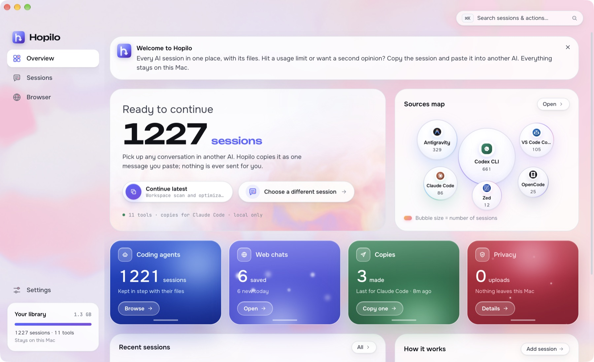

  

<h1 align="center">Hopilo</h1>

  <strong>Universal AI Session Handoff · Offline by Default & Local-First</strong> 
  Every AI session in one place, with its files. Copy any of them, ready to paste into another AI.

  
  
  
  
  

  

---

  

## Features

- Keep AI conversations and files together in one local library.
- Copy or export sessions to continue in another AI.
- Import chats from local tools, browser captures and data exports.
- Preview files, search conversations and back up your library.

## Install

Get the latest build from [Releases](https://github.com/kiron0/hopilo/releases/latest).

- **macOS:** open the `.dmg` and drag Hopilo into Applications.
- **Windows:** run the `.msi` or `.exe` installer.
- **Linux:** install the `.deb` or run the `.AppImage`.

Optional browser extensions are included with each release.

## License

Licensed under the [Apache License, Version 2.0](LICENSE).

© [Toufiq Hasan Kiron](https://github.com/kiron0). All rights reserved.

